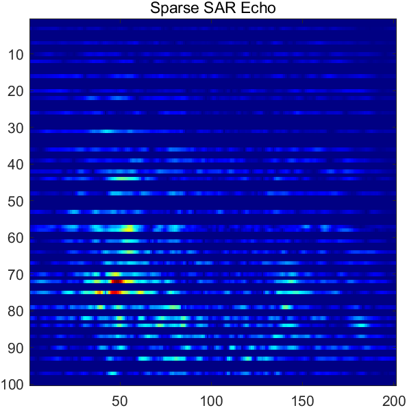
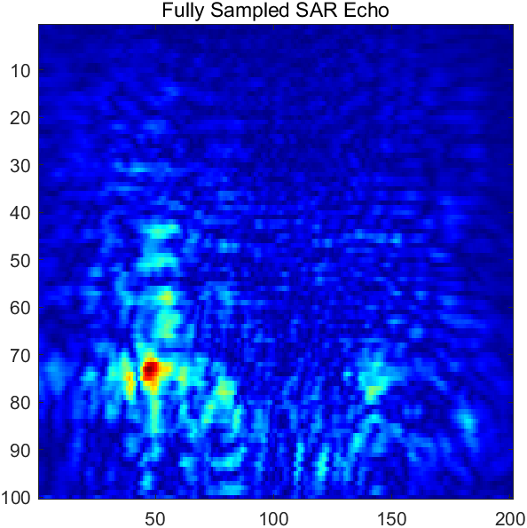
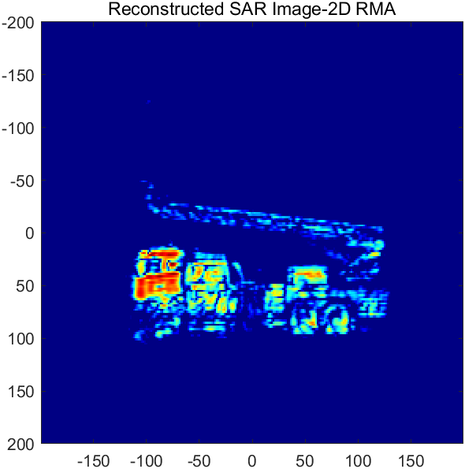
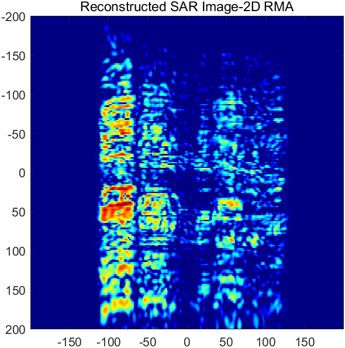
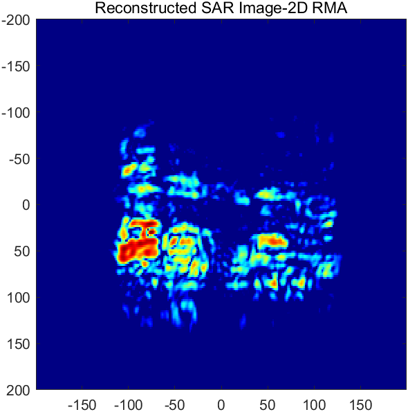
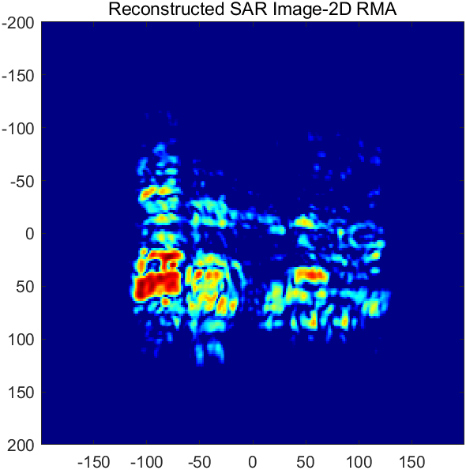

# Farewell to the "Whole Sampling" Era: A New Paradigm for Low-Rank Matrix Completion in Structured Sparse Millimeter Wave Three-Dimensional SAR Imaging [With MATLAB Code]

Farewell to the "Whole Sampling" Era: A New Paradigm for Low-Rank Matrix Completion in Structured Sparse Millimeter Wave Three-Dimensional SAR Imaging
Introduction: Millimeter wave three-dimensional synthetic aperture radar (SAR) imaging often requires dense grid scanning on a two-dimensional plane, which is time-consuming and data-intensive. By retaining only a few sampling locations during the scan process and then reconstructing complete images from "deficient" echoes using algorithms, hardware burden and imaging time can be significantly reduced.This paper systematically introduces two matrix completion methods for structured sparse millimeter-wave three-dimensional SAR imaging, namely TCTA and TVNNA, based on the latest research works published in "IEEE Transactions on Aerospace and Electronic Systems" and "Radar Journal (English Edition)".Abstract: In the field of millimeter-wave three-dimensional SAR imaging, this paper introduces two matrix completion methods. The first is TCTA (Toeplitz-Column-Toeplitz ADMM), which utilizes a two-level Toeplitz enhancement to map the two-dimensional echo slices into an uplifting matrix with strong low-rank structure. It also employs an ADMM solver for low-rank factorization in the iteration process to avoid singular value decomposition (SVD) and achieve efficient completion.The second method is TVNNA (Total Variation and Nuclear Norm ADMM), which introduces a second-order total variation (TV) smoothness regularization based on low-rank priors, and solves it through alternating optimization in the ADMM framework with soft thresholding, SVD thresholding, and Sylvester equations. Both methods complete imaging after sparse sampling echo reconstruction by applying a two-dimensional distance-migrate algorithm (RMA). Experiments show that under various structural sparse sampling patterns (uniform sparse, non-uniform sparse, Z-shaped sparse), both methods can recover high-quality echoes at a sampling rate of 15%–50%, and reconstruct clear SAR images.
Keywords: Millimeter Wave SAR; 3D Imaging; Matrix Completion; Toeplitz Structure; Total Variation; Kernel Norm; ADMM; Distance-Doppler Algorithm
1. 1.1 Why is "sparse" imaging needed? Millimeter wave (mmWave) frequency band combines high resolution with good penetration. Moreover, it is more cost-effective compared to terahertz systems. The device is more mature. Consequently, in human body security inspections. Non-destructive testing It has received widespread attention in scenarios such as concealed target detection. The typical working mode of millimeter-wave near-field 3D SAR imaging is: the radar performs grid scanning on a two-dimensional plane perpendicular to the wave propagation direction. Collecting target echoes point by point. Then, the three-dimensional image of the target is focused in the range-azimuth domain through an imaging algorithm.
However, there are two prominent issues with this "point-by-point full sampling" model:
Data volume: The number of sampling points in two-dimensional scanning is directly related to the imaging area and sampling interval, full sampling means a huge data storage and transmission burden.
Longer acquisition time: The scanning mechanism needs to traverse every pixel position. The more sampling points, The longer the mechanical motion and data collection take, Difficult to meet real-time or near-real-time application requirements.
A natural thought is: Can we only scan a subset of positions and then "complete" the missing echoes through an algorithm? This is the imaging approach known as "Sparse Sampling + Matrix Completion" (MC).
1.2 From stochastic sparse to structured sparse, classical compression-sensing and matrix completion theories often assume random sampling locations. However, in actual millimeter wave scanning systems, it is often difficult to achieve ideal random sampling - due to the scanning mechanism typically moving along a straight line or grid, sampling locations are more likely to form uniformly spaced rows/columns sparse, non-uniform rows/columns sparse, or zig-zag (zigzag) sparse patterns.
1.3 The solution approach to the above challenges is introduced in this paper, which introduces two complementary methods:
TCTA: Upgrades the echo slice into a two-tier Toeplitz-Column-Toeplitz (TCT) matrix, utilizing the enhanced low rankness of the upgraded matrix for completion, and completely avoids SVD iteration process, with low computational complexity;
TVNNA: Based on the low rank prior (minimizing nuclear norm), jointly utilizes second-order TV smoothing regularization, while simultaneously constraining the matrix's low rank structure and local smoothness, making it more robust to structural sparseness.
Both methods complete the echo recovery through two-dimensional RMA, forming a complete processing link from "sparse sampling → matrix completion → RMA imaging".
2.1 Sparse Sampling Observation Model Set the fully sampled distance-compressed echo slice as a complex matrix S∈ℂ^(M×N), where rows correspond to distance dimensions and columns correspond to scanning azimuthal dimensions. Define a binary sampling mask Ω∈{0,1}^(M×N), and the observation data are:
S_obs = Ω⊙S
where ⊙ represents element-wise multiplication, and unobserved positions are filled with zeros. The task of matrix completion is to recover the complete S from S_obs, that is, solving the following inverse problem:
minrank(X)  s.t.  X(Ω) = S_obs(Ω)
Since the rank function is non-convex and NP-hard, it is usually relaxed to minimize the nuclear norm. However, the simple nuclear norm has limited performance under structural sparseness, hence both methods introduce stronger structural priors.
2.2 The design method for sampling patterns covers four typical sparse sampling patterns, fully corresponding to the movement constraints of actual scanning mechanisms:
Category  
Specific pattern  
Example sampling rate  
Random sparse  
Randomly uniformly selecting samples  
20%  
Structural sparse (uniform)  
Retaining rows/columns at equal intervals  
50%, 25%  
Structural sparse (non-uniform)  
Retaining rows/columns according to preset indices  
30%, 25%, 20%, 15%  
Zigzag sparse  
Retaining rows/columns in segments  
50%, 33.3%, 25%  
These patterns provide rich experimental scenarios for algorithm verification, especially examining the challenging scenario of missing entire rows/columns.
III. Method One: TCTA - Two-Level Toeplitz-Enhanced Low-Rank Completion
3.1 Core Observation: The core observation of TCTA is that the distance compression backscatter slices of mmWave SAR do not directly satisfy strong low-rankness in the spatial domain. However, after two levels of Toeplitz enhancement, their enhancement matrices often have a much higher low-rank structure than the original data. By mining this hidden structure, even with very low sampling rates or even complete row and column missing, the completion performance can be significantly improved.
3.2 Two-Level Toeplitz-Column-Toeplitz (TCT) Enhancement TCT enhancement includes two levels:
1  
First level (column-to-Toeplitz): For each column s_i of the backscatter slice S, construct a Toeplitz matrix, where the first column is itself, and the rest are obtained by shifting the column. Thus, each column vector is "expanded" into an M×P Toeplitz block, where P is the pencil parameter of the first level;
Second-level (Block-wise Toeplitz): Consider N blocks of Toeplitz as a "column block sequence," perform another Toeplitz shift and concatenation along the block direction, resulting in Q stacked block groups that are horizontally concatenated to form a two-tier TCT matrix T with dimensions (M·N)×(P·Q).
In mathematics, this can be written as:
T = TCT(S, P, Q)  
The inverse transformation restores the M×N original slice of the matrix by diagonally averaging the recurring Toeplitz elements, ensuring information is not lost and noise can be suppressed.
3.3 In the TCT improvement domain, the completion problem is transformed into low-rank completion of the lifting matrix \(T\). The TCTA employs a low-rank factorization strategy, explicitly expressing the rank constraint as:
T ≈ U·V^T  
Among them, U ∈ ℂ(MN×r), V ∈ ℂ(PQ×r), r is the estimated rank. The algorithm flow is as follows:
Initialization: Perform an initial U and V factor decomposition of the observed lifting matrix through Alternating Least Squares (ALS), while simultaneously initializing the dual variable Z to 0 and the complementary solution X to S.
ADMM Iteration (K times):
1  
Update X: Observation position remains unchanged, missing positions are filled by the inverse mapping of the promotion domain: X = Ω⊙S + (1−Ω)⊙Inverse_TCT(U·V^T − Z/μ);
2  
Update U, V: Regularized least squares update of factor matrix with Ridge (analytical solution, no SVD);
3  
Update Z: Accumulate residuals according to ADMM rules: Z ← Z + μ(T_X − U·V^T);
4  
Convergence judgment: Stop criteria based on the relative Frobenius norm change.
Key Advantages: Due to the only matrix multiplication and linear equation solving in the iteration, SVD computation is completely avoided, thus the computational complexity of TCTA is significantly lower than that of classical kernel norm-based methods, especially suitable for scenarios with large post-processing matrices (the post-processing matrix in this method can reach a scale of MN×PQ).
3.4 Parameter Settings
Meaning
Example Value
P, Q
Two-level pencil parameters
P = Q = 10
e_rank
Estimated rank of the boosted matrix
20
μ
ADMM penalty parameter
2
K
Maximum number of iterations
30
IV. Method Two: TVNNA - Low-Rank and Smoothness Jointly Regularized Complementation
4.1 Core Concept: TVNNA takes another perspective: although SAR echo slices are not strongly low-rank in the spatial domain, they possess both global low-rankness and local smoothness—the magnitude and phase of echoes at neighboring scanning positions usually change slowly. TVNNA models these two aspects jointly, solves them under the ADMM framework through "kernel norm + second-order TV" hybrid regularization, making it more robust to structured sparse data.
4.2 Optimization Model: Let the missing matrix be Sc, construct an augmented row difference matrix L ∈ ℝ((M−2)×M) and an augmented column difference matrix R ∈ ℝ(N×(N−2)), then the optimization model is:
min ‖Sc‖_* + λ·(‖L·Sc‖_F² + ‖Sc·R‖_F²)  s.t.  Sc(Ω) = S_obs(Ω)
where ‖·‖_* is the kernel norm (low-rank prior), ‖L·Sc‖_F² + ‖Sc·R‖_F² is the second-order TV smoothing term, λ balances the weights of both. λ can be taken as the reciprocal of the sampling rate—the lower the sampling rate, the larger λ, meaning it relies more on the smoothness prior, reflecting the adaptive association between regularization weight and data missing degree.
4.3 The ADMM method introduces three auxiliary variables: A = L·Sc, B = Sc·R, and C = Sc, along with Lagrangian multipliers Y1, Y2, Y3. This transforms the constrained problem into a separable structured extended Lagrangian problem, which can be efficiently solved for each subproblem.
1  
Update A, B: Closed-form soft thresholding solution, A = ρ/(ρ+2λ)·(L·Sc − Y1/ρ), B in the same manner, reflecting TV smoothness constraints;
2  
Update C: Perform SVD on W = Sc − Y3/ρ, singular value soft thresholding (kernel norm proximal operator), and then enforce the observational values C(Ω) = S_obs(Ω);
3  
Sc: Coupling the three sub-problems into solving Sylvester equations, where the coefficient matrix is (LT L + I) and (R RT), using a mature numerical solver to complete the task in one step. This is key to the overall computational efficiency of the algorithm.
4  
Update the scalars and penalty parameters: Y1, Y2, Y3 are updated according to the standard ADMM with the penalty parameter ρ multiplied by μ1 (in the example, μ1 = 1.25, and a cap is set to prevent numerical divergence).
5  
Stopping criterion: Terminate early when the relative Frobenius norm changes less than a threshold tol (e.g., 1e-6).
4.4 Parameter Settings
Meaning
Example value
λ  
Second-order TV weight
1/Sampling rate
ρ  
Initial ADMM penalty parameters
1  
μ1  
Penalty parameter growth rate
1.25  
maxIter  
Maximum number of iterations
100  
tol  
Convergence threshold
1e-6  
V. Imaging Algorithm: After completing matrix completion with the two-dimensional range motion algorithm (RMA), the recovered echo slices can be subjected to two-dimensional RMA imaging, which involves the following steps:
1  
Band-domain construction: Construct a grid in the kX and kY domains using the carrier wave number k = 2π·f0/c and the spatial sampling interval dx, dy. Additionally, calculate kz = sqrt((2k)² − kX² − kY²), setting it to zero if it exceeds the radiation range.
2  
Phase compensation: Generate the matching filter factor, phaseFactor = exp(−i·z0·kz), where z0 is the propagation distance from the radar to the selected range slice, and then multiply by kz to obtain the wavenumber domain weighting factor.
3  
Zero-padding: Zero-padding the echo slices to a square wavenumber domain of nFFTspace×nFFTspace to avoid aliasing and improve image domain sampling density;
4  
Focused imaging: perform a two-dimensional FFT on the echoes, then multiply each point with the phase factor and perform a two-dimensional IFFT to obtain the focused image.
5  
Display: Modulus, normalization and displayed in dB. The dynamic range is set to [−40, 0] dB.
RMA is an accurate wavenumber domain imaging algorithm, which is more efficient than traditional time-domain back projection (BP) and more precise than the distance-Doppler approximation in near field large aperture.
6. Experimental setup and results analysis: Data and experimental scene data: A set of typical millimeter-wave near-field distance compression echo slices, including complex echo matrix, scanning intervals (dx, dy, in millimeters), imaging distance z0, radar and imaging parameters (carrier frequency f0, speed of light c, modulation slope, sampling rate, number of distance-axis sampling points, number of FFT points in wavenumber domain);
Scenario: Examine four categories of patterns, namely random sparseness, uniform row/column sparseness, non-uniform row/column sparseness, and graph sparsity, in order. The sampling rate covers 15%–50%.
6.2 Complete processing flow The entire method's processing flow is as follows:
1  
Read data to obtain full-sampling echoes;
2  
Construct a sparse mask and apply it to the echo, resulting in sparse echo.
3  
Invoke TCTA or TVNNA for completion, and obtain the reconstructed echoes.
4  
Perform a two-dimensional RMA on the reconstructed backscatter to obtain the final SAR image.
5  
Statistical sampling rate, reconstruction error and overall time consumption are used to evaluate the performance of the method.
6.3 Typical Results: The following figure provides an intuitive comparison of echo and imaging results across various stages (from left to right: full sampling, sparse, TCTA reconstruction, TVNNA reconstruction):
Echo Domain
Full-sampling image
Sparse image
TCTA Reconstructed Image
TVNNA Reconstructed Image
full_image  
sparse_image  
tcta_image  
tvnna_image  
It can be seen that under sparse sampling conditions (approximately 30% row sparseness in the figure), direct imaging would suffer from significant streaking and information loss due to missing echoes. However, after TCTA/TVNNA completion, the reconstructed echoes are highly consistent with those of full sampling, resulting in clear final imaging with significantly reduced artifacts, approaching the image quality of full sampling benchmarks.
6.4 Summary of method characteristics
TCTA  
TVNNA  
Prior model
Two-level Toeplitz lifting with low rank
Low-norm nuclear norm + second-order TV smoothing
Iterative approach
Low-rank factorization ADMM (without SVD)
ADMM (including SVD soft threshold)
Key operations
Matrix multiplication + Ridge regression
SVD + Sylvester equation
Iterative update quantity
Smaller, suitable for large-scale matrices.
As the scale of problems increases.
Applicable scenarios
Strongly structured sparse, ultra-large scale data
Smooth echoes, extremely low sampling rates
VII. Conclusion and Prospects The two matrix completion methods introduced in this paper have overcome the core challenges of structured sparse millimeter wave three-dimensional SAR imaging from different perspectives:
TCTA has proven the power of "structural enhancement" — by using a two-stage Toeplitz lifting to transform "non-low rank" data into "strong low rank" data, and then efficiently solving it with an ADMM without SVD factorization. This approach significantly enhances computational efficiency.
TVNNA has proven the value of "multi-prior fusion" - the low rankness and local smoothness complement each other, making the algorithm robust even in the structured missing mode, and the design of λ and sampling rate adaptive is simple and effective.
The two together form a complete technical chain of "sparse sampling → low-rank completion → wavenumber domain imaging", providing reliable algorithm support for the acceleration of acquisition in millimeter wave near-field 3D imaging. Future work can be expanded in the following directions:
1  
Promote the method to full 3D (multi-distance slice) joint completion, further utilize the distance dimension correlation;
2  
Combine deep learning to develop networks, realizing end-to-end rapid completion and imaging;
3  
Robustness verification on real mm-wave systems under different scanning constraints;
4  
Exploring more complex non-regular sampling patterns and adaptive sampling strategies.
References [1] Z. Tan, Z. Chen, Y. Liu, Z. Li, S. Gao, and Y. Liu, "Structured Sparse Millimeter-Wave 3-D SAR Imaging via Truncated-DCT and Toeplitz Matrix Methods," IEEE Transactions on Aerospace and Electronic Systems, vol. 62, 2026. DOI: 10.1109/TAES.2026.3686779.
[2] Z. Tan, Z. Chen, H. Tang, P. Mou, and Y. Liu, "Fast Structured Sparse Millimeter-Wave 3D SAR Imaging Based on Low-rank and Smooth Matrix Completion," Journal of Radars, 2026. DOI: 10.12000/JR25267. 
This article is compiled from the above two research papers and their project documents, with the algorithm details based on the original paper text.

## Images

<!-- PAYMENT_BLOCK -->

## Get this dataset

- Payment link (Stripe): [Buy now](https://buy.stripe.com/3cs8yP7sY87d0vu9AB)
- Payment QR code: 

<!-- /PAYMENT_BLOCK -->
